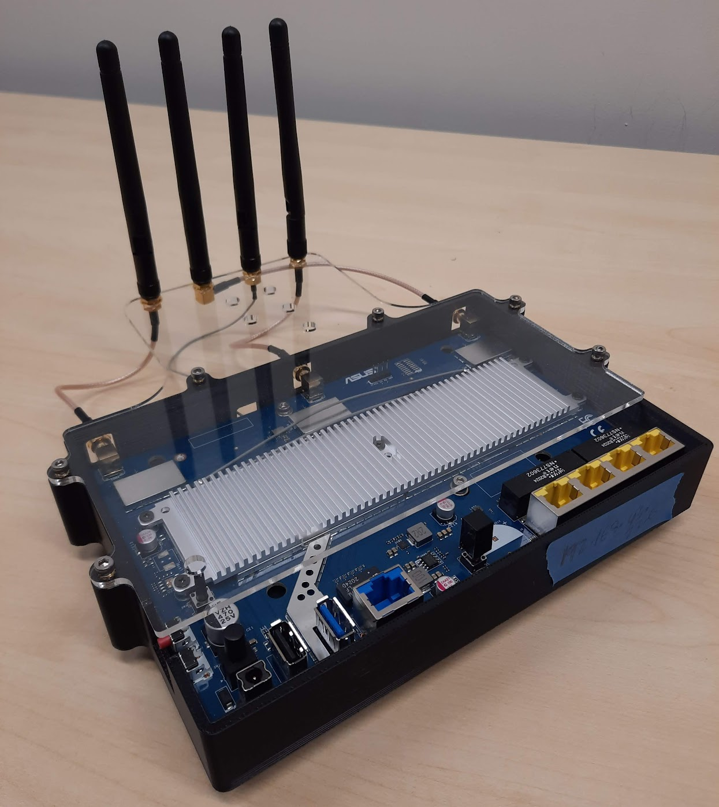

# CSI router and Python receiver

Collect Wi-Fi Channel State Information (CSI) with Nexmon-compatible ASUS
RT-AC86U routers, decode it on paired Raspberry Pis, and publish matrices to
[Server-central](https://github.com/WIRES-UB/Server-central) over MQTT.
The supported workflow uses `src/pythonNoRos/nexcsiserver.py`.

<p align="center">  </p>

## Architecture and requirements

```text
Phone Wi-Fi packets → capture router (passive or AP+CSI ) → LAN cable → paired Pi → Wi-Fi → central MQTT
```

Each Pi connects to its capture router over Ethernet and to the central server
over Wi-Fi. Connect the Ethernet cable to a router **LAN port**. Keep the
router's Ethernet subnet separate from the server Wi-Fi subnet, and leave the
Pi's default route on Wi-Fi. All capture radios must share the phone AP's channel
and bandwidth. Give the server and Pis stable Wi-Fi addresses, assign unique
router/receiver IDs, and add the phone's actual per-network Wi-Fi MAC to the
receiver allowlists.

There are two router roles:

| Role | Driver and setup | Phone association |
| --- | --- | --- |
| Passive capture | `dhd.ko`, `setup.sh` / `configcsi.sh`; monitor mode | Phone connects to another AP on the capture channel |
| AP+CSI | `dhd-ap-concurrent.ko`, supervised `ap-csi-autostart.sh` | Router also serves the phone's Wi-Fi network |

The AP+CSI binary targets **BCM4366c0, PHY revision 33, firmware 10.10.122.20,
Linux 4.1.27**. Confirm model, firmware, SSH access, and persistent `/jffs` before
installing either driver. These modules are not generic router firmware images.
Copying them does not install a compatible operating system. Keep an untouched
OEM driver and working Ethernet management access.

## Setup

Replace `<...>` values with your deployment settings. Run the Pi commands on each
paired Pi, using Raspberry Pi OS/Linux with NetworkManager, Python 3, and systemd.

### 1. Prepare the Pi and its networks

```bash
sudo apt-get update
sudo apt-get install -y git python3-venv network-manager sshpass
sudo install -d -o "$USER" -g "$(id -gn)" /opt/wiros_csi_node
git clone --branch dev https://github.com/WIRES-UB/wiros_csi_node.git /opt/wiros_csi_node
cd /opt/wiros_csi_node
python3 -m venv .venv
.venv/bin/pip install -r requirements.txt
```

Connect the Pi to the same Wi-Fi network as the central server:

```bash
nmcli --ask device wifi connect <SERVER_NETWORK_SSID> ifname <WIFI_INTERFACE>
```

Reserve the Pi's Wi-Fi address in that network's DHCP settings. Configure the
router with a static management address through its web interface, enable LAN
SSH and persistent JFFS storage, and give the Pi a different address in that
same capture subnet:

```bash
sudo sh deploy/configure-pi-ethernet.sh <PI_ETHERNET_IP/PREFIX>
ip -4 address show eth0
ip route
ping -I eth0 -c 3 <ROUTER_ETHERNET_IP>
ssh <ROUTER_USER>@<ROUTER_ETHERNET_IP> 'uname -a; test -d /jffs'
```

The helper uses `eth0` and creates/updates `wiros-router` with
`ipv4.never-default=yes`. For another Ethernet interface, create the equivalent
NetworkManager profile with that interface. Do not add a gateway to the capture
link. Physically isolated pairs may reuse a subnet; bridged links may not.
Older router SSH servers may require `-o HostkeyAlgorithms=+ssh-rsa`.

### 2. Install router assets and choose its role

From the Pi, set shell variables used in the remaining commands:

```bash
export ROUTER_HOST='<ROUTER_ETHERNET_IP>'
export ROUTER_USER='<ROUTER_SSH_USER>'
export CHANNEL='<PRIMARY_CHANNEL>'
export BANDWIDTH='<20_40_OR_80>'
```

On a router still running its stock driver, back up `/jffs/csi` if it exists and
copy the assets. Avoid overwriting a driver file that is currently loaded through
a bind mount; stop its supervisor and return to stock first when upgrading.

```bash
ssh "$ROUTER_USER@$ROUTER_HOST" \
  'test ! -d /jffs/csi || cp -a /jffs/csi "/jffs/csi.backup-$(date +%Y%m%d-%H%M%S)"'
scp -O -r nexmon_firmware/csi "$ROUTER_USER@$ROUTER_HOST:/jffs/"
ssh "$ROUTER_USER@$ROUTER_HOST" 'chmod u+x /jffs/csi/*.sh /jffs/csi/nexutil /jffs/csi/makecsiparams'
```

**Passive router:** run the following once after each stock boot. It loads the
passive driver, configures the radio, and forwards CSI broadcasts over Ethernet.
The final argument keeps capacity for four transmit streams; the receiver uses
four receive chains by default.

```bash
ssh "$ROUTER_USER@$ROUTER_HOST" \
  "/jffs/csi/setup.sh $CHANNEL $BANDWIDTH 4"
```

`setup.sh`/`reload.sh`/`configcsi.sh` are for passive routers: they bring down the
capture radio's AP service. For automatic passive initialization, the receiver's
`--configure-router` option runs this same setup and requires `ROUTER_PASSWORD`
and `sshpass`. The supplied receiver service only receives; it does not configure
the router on startup.

**AP+CSI router:** configure the desired SSID, fixed primary channel, and width
in the stock web interface, then follow [AP+CSI startup](#apcsi-startup). Do not
run the passive setup command or `--configure-router` on this router.

### 3. Configure the Python receiver

Create `src/pythonNoRos/config.json` on each Pi; this file is intentionally
untracked. Replace every placeholder and choose the channel/width used above
(the numeric values below are examples):

```json
{
  "router": {
    "id": "<UNIQUE_ROUTER_ID>",
    "host": "<ROUTER_ETHERNET_IP>",
    "username": "<ROUTER_SSH_USER>",
    "password": ""
  },
  "receiver": {
    "id": "<UNIQUE_RECEIVER_ID>",
    "bind": "0.0.0.0",
    "port": 5500,
    "receive_buffer_bytes": 4194304
  },
  "capture": {
    "channel": 36,
    "bandwidth_mhz": 80,
    "tx_streams": 4,
    "rx_cores": 4,
    "mac_filters": ["<PHONE_WIFI_MAC>"]
  },
  "mqtt": {
    "host": "<CENTRAL_SERVER_HOST>",
    "port": 1883,
    "topic": "/csi",
    "qos": 0
  }
}
```

Add all collection phones to `mac_filters`, using complete colon-separated
addresses. Record the MAC actually used on the phone AP; per-network randomized
addresses can differ from the phone's hardware address. For AP+CSI only, also set
`capture.require_coherent_snapshot` to `true`. Keep `tx_streams` and `rx_cores`
at four for the packaged AP driver.
Set Server-central's `CSI_ROUTER_IDS` to the exact set of `router.id` values.

Start the central broker, then run the receiver in the foreground:

```bash
.venv/bin/python src/pythonNoRos/nexcsiserver.py --config src/pythonNoRos/config.json
```

Generate traffic from an allowed phone. Logs should show incoming datagrams and
completed matrices. If needed, allow UDP
5500 on the Pi's Ethernet interface. Stop the foreground receiver before
installing the service so two processes do not compete for packets.

```bash
sudo install -m 0644 deploy/wiros-csi-node.service /etc/systemd/system/
sudo systemctl daemon-reload
sudo systemctl enable --now wiros-csi-node.service
journalctl -u wiros-csi-node.service -n 50 --no-pager
```

### AP+CSI startup

The router must **boot the untouched OEM driver first**. The Pi supervisor performs the late switch after
stock AP startup. The installer verifies driver hashes and the existing AP/channel
before unloading anything. It does not change the SSID, channel, or NVRAM.

On the stock router, create `/jffs/csi/ap-csi.env` with:

```sh
AP_CSI_INTERFACE=eth6
AP_CSI_SSID='<PHONE_AP_SSID>'
AP_CSI_CHANNEL=<PRIMARY_CHANNEL>
AP_CSI_BANDWIDTH_MHZ=<CHANNEL_WIDTH>
AP_CSI_TX_STREAMS=4
AP_CSI_RX_CORES=4
AP_CSI_MIN_INTERVAL_MS=1
AP_CSI_TARGET_MAC='<PHONE_WIFI_MAC>'
AP_CSI_EXPECTED_STOCK_MD5=<VERIFIED_COMPATIBLE_OEM_MODULE_MD5>
AP_CSI_EXPECTED_CANDIDATE_MD5=<VERIFIED_CANDIDATE_MODULE_MD5>
```

`AP_CSI_TARGET_MAC` accepts up to four comma-separated full addresses; keep it
consistent with the Pi allowlist. The fixed 1 ms interval controls export of the
saved matrix, not a promise of 1,000 complete captures per second. Verify file
hashes using `md5sum` and `sha256sum`; investigate compatibility mismatches rather
than accepting an unknown module. The packaged AP driver's SHA-256 is
`9a08f5f8f2d4ca83dca178f222af1f4ae4c529a715697639dfd0e661fd7651d2`.

On the paired Pi, store the router password outside the repository:

```bash
install -d -m 0700 "$HOME/.config/wiros" "$HOME/.ssh"
read -rsp 'Router SSH password: ' ROUTER_PASSWORD; echo
printf '%s\n' "$ROUTER_PASSWORD" > "$HOME/.config/wiros/ap_csi_router_password"
chmod 0600 "$HOME/.config/wiros/ap_csi_router_password"
unset ROUTER_PASSWORD
sudo install -m 0755 nexmon_firmware/csi/ap-csi-rpi-watchdog.sh /usr/local/sbin/ap-csi-rpi-watchdog
sudo install -m 0644 nexmon_firmware/csi/ap-csi-rpi-watchdog.service /etc/systemd/system/
```

Create `/etc/default/ap-csi-rpi-watchdog` with literal absolute paths (systemd
will not expand `$HOME` in this file):

```sh
AP_CSI_ROUTER_HOST=<ROUTER_ETHERNET_IP>
AP_CSI_SOURCE_IP=<PI_ETHERNET_IP>
AP_CSI_LINK_INTERFACE=eth0
AP_CSI_ROUTER_USER=<ROUTER_SSH_USER>
AP_CSI_RADIO_INTERFACE=eth6
AP_CSI_PASSWORD_FILE=/home/<PI_USER>/.config/wiros/ap_csi_router_password
AP_CSI_KNOWN_HOSTS=/home/<PI_USER>/.ssh/ap_csi_router_known_hosts
AP_CSI_DISABLE_FILE=/home/<PI_USER>/.config/wiros/ap_csi_disabled
AP_CSI_INFLIGHT_FILE=/home/<PI_USER>/.config/wiros/ap_csi_install_inflight
```

## Operation and troubleshooting

The AP firmware copies active estimates into a protected RAM snapshot, then
exports rows without holding the radio across timer callbacks. At 80 MHz the
matrix retains `4 × 4 × 256` capacity. Unused antenna combinations and frequency
bins are exact zero. The receiver validates capture identity, rejects conflicting
or incomplete row sets, decodes signed coefficients, centers subcarriers, and
publishes flattened real/imaginary arrays in transmit/receive/subcarrier order.
Metadata distinguishes measured streams from capacity. Heavy traffic can reduce
accepted capture rate; overwritten estimates are discarded rather than combined.

Check the path in order:

```bash
ip route
ping -I eth0 -c 3 "$ROUTER_HOST"
systemctl status wiros-csi-node.service --no-pager
journalctl -u wiros-csi-node.service -n 50 --no-pager
sudo ss -ulnp | grep ':5500'
```

- **No datagrams:** check the LAN cable, Ethernet address, driver setup, bridge,
  channel, and UDP firewall. Passive setup must run again after a router reboot.
- **Datagrams but no matrices:** check the phone MAC and configured stream/core
  counts. For AP+CSI, verify snapshot mode and both firmware/Pi MAC filters.
- **Matrices but no stored phone samples:** check the central broker address,
  server router-ID list, and phone MQTT path. An isolated phone LAN needs the Pi
  MQTT bridge documented in Server-central; the receiver itself is not a broker.
- **Disabled AP supervisor:** inspect its journal and persistent latch before
  retrying. Keep management on Ethernet during recovery.

## Rebuild the AP driver

The compiled driver is included. To rebuild, use Linux x86-64 and the pinned
Nexmon and Nexmon CSI checkouts. On Debian/Ubuntu, first install `git`, `make`,
`gcc`, `g++-multilib`, `gawk`, `flex`, `bison`, `qpdf`, `python3`, `patch`, and
`zlib1g-dev`. Enable i386 packages with `sudo dpkg --add-architecture i386`, run
`sudo apt-get update`, and install `libc6:i386` and `libstdc++6:i386` for the
bundled 32-bit compiler. Then build the tools and driver:

```bash
git clone https://github.com/seemoo-lab/nexmon.git /path/to/nexmon
git -C /path/to/nexmon checkout 68720406f54ff16cad28fd3c51f2392aefad9fb7
git clone https://github.com/seemoo-lab/nexmon_csi.git /path/to/nexmon_csi
git -C /path/to/nexmon_csi checkout 1232edf2cf1e7ae0561676c49e4dd4eb22c8a27e
make -C /path/to/nexmon/buildtools/gcc-nexmon-plugin
make -C /path/to/nexmon/buildtools/b43-v2/assembler
make -C /path/to/nexmon/buildtools/b43-v2/disassembler
make -C /path/to/nexmon/buildtools/flash_patch_extractor
make -C /path/to/nexmon/buildtools/ucode_extractor
nexmon_firmware/csi/build.sh /path/to/nexmon /path/to/nexmon_csi /tmp/dhd-ap-concurrent.ko
```

The build script works in an isolated build directory and prints the artifact
hash; it never installs firmware.
Do not run upstream `install-firmware` targets on a deployment host.

## Attribution

This repository derives from [WiROS](https://github.com/ucsdwcsng/WiROS) and
[Nexmon CSI](https://github.com/seemoo-lab/nexmon_csi). Retain their licenses and
cite Nexmon and the CSI extractor when using this work in research:

- Matthias Schulz, Daniel Wegemer, and Matthias Hollick. *Nexmon: The C-based
  Firmware Patching Framework* (2017), [nexmon.org](https://nexmon.org).
- Francesco Gringoli, Matthias Schulz, Jakob Link, and Matthias Hollick.
  *Free Your CSI: A Channel State Information Extraction Platform For Modern
  Wi-Fi Chipsets*, WiNTECH 2019, [DOI: 10.1145/3349623.3355477](https://doi.org/10.1145/3349623.3355477).
